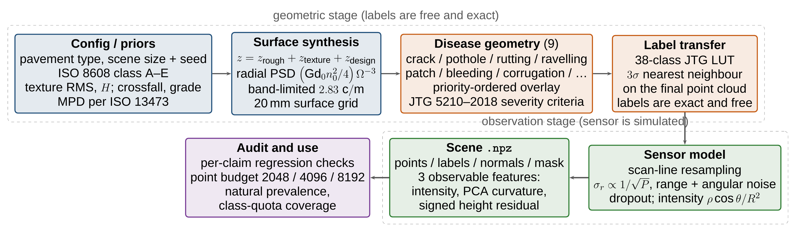
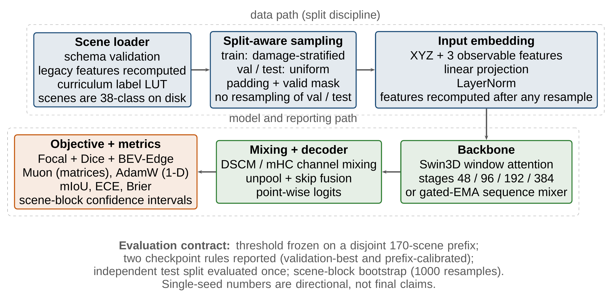

<div align="center">

# RoadMC

**Physics-grounded pavement point-cloud synthesis and damage segmentation**

Synthetic point clouds · observable features · Swin3D / gated-EMA · channel mixing · Muon / AdamW

[中文](README.md)

</div>

> RoadMC is a research prototype that builds a reproducible path from physics-inspired pavement point-cloud synthesis, through point-wise damage segmentation, to real-domain gap diagnostics. All published performance evidence covers binary segmentation on synthetic data only; there is no labelled real-domain result.

## Project Scope

RoadMC has two equally important components:

1. **Point-cloud synthesis**: generates labeled pavement scenes from road roughness, micro-texture, damage geometry, and a LiDAR observation model.
2. **Model training**: predicts a damage class for every point from coordinates and sensor-observable features.

Synthetic data is part of the method, not preprocessing. It controls geometry, class coverage, rare-damage support, and the physical plausibility of the training distribution. Every generator setting is therefore stored with the scenes it produced, so a reported number can be traced back to the configuration behind it.

## Method Overview

### Physics-based point-cloud synthesis

<p align="center">
  
</p>

The synthesis pipeline moves from pavement priors through surface realization, damage deformation, LiDAR observation, and scene export. Point-wise labels originate with the geometry and follow observation resampling; controlled scenes sample their target class at natural prevalence with only a minimum-survival floor, and every intervention is written to audit fields. Observable features are computed only from the final points and intensity.

### Model training and evaluation

<p align="center">
  
</p>

The training pipeline moves from scene loading and split-aware sampling through input embedding, backbone encoding, channel mixing and decoding, and loss and metric aggregation:

```text
road morphology + damage deformation + LiDAR observation
        -> labeled scene files (.npz)
        -> observable input features
        -> Swin3D / gated-EMA + channel mixing
        -> point-wise logits and global evaluation reports
```

## Current Status

| Item | Current status |
| --- | --- |
| Task | Binary: background `0` / damage `1`. The 38-class space has labels and curriculum hooks only — **no multi-class performance numbers exist** |
| Headline result (30 epochs) | ✅ Test disease IoU `0.5483` [0.5126, 0.5820], frozen threshold 0.370, ECE 0.0069 |
| Comparison point (15 epochs) | Test disease IoU `0.4781` [0.4435, 0.5105], frozen threshold 0.320, ECE 0.0028 |
| Historical baseline | `0.7235`, produced by the removed fixed-10%-quota generator and additionally affected by an intensity label leak — **no longer valid evidence** |
| Model | `Swin3D + DSCM + Muon/AdamW`, ~7.3M parameters |
| Architecture comparison | ✅ Five mainstream point-cloud segmentation networks run to 30 epochs under the identical protocol (see below) |
| Channel-mixing ablation | ✅ Four variants × three seeds complete; between-variant differences are smaller than within-variant spread, **no mechanistic claim** |
| Generator realism options | ✅ Roughness mixture, along-track texture heterogeneity, curb strip, radiometric calibration — all implemented, all off by default, v2 behaviour unchanged |
| Generator behaviour fixes | ✅ The 2026-10 fix batch is in: ISO-marginal macro-spectrum reweighting, Bernoulli disease sampling, fixed-absolute AGC calibration, geometry corrections for potholes / rutting / depressions / cracks / concrete distresses — **default output changes**; every legacy behaviour is kept behind an explicit rollback flag (see "Generator behaviour fixes and rollback"); new-vs-old comparison numbers **pending re-validation** |
| Domain-gap diagnostics | v2 joint MMD `0.136` (41 frames), replicated at `0.1368` on a 441-frame subset; the realism-config comparison is **pending re-validation** (the implementation was lost and re-written to spec in 2026-10; numbers to be backfilled) |
| Real-domain performance | No real semantic mIoU. The available M2S-RoAD samples are unlabelled and used only for domain-gap diagnostics |

## Results

Everything below was obtained on synthetic data, with binary labels, and from a single seed unless stated otherwise. None of it extrapolates to real roads or to the 38-class task.

### Baseline v2 and the effect of training length

Data: `credibility_v2` (4160 / 855 / 855 scenes, 2048 points each), natural-prevalence sampling, no label leakage, independent train/val/test split, threshold selected on a validation prefix and then frozen:

| Metric | 15 epochs | 30 epochs |
| --- | --- | --- |
| Validation IoU | 0.4608 | 0.5219 [0.4811, 0.5604] |
| **Test disease IoU** | **0.4781** [0.4435, 0.5105] | **0.5483** [0.5126, 0.5820] |
| Frozen binary threshold | 0.320 | 0.370 |
| Precision / Recall (foreground) | 0.7092 / 0.5947 | 0.8091 / 0.6298 |
| ECE / Brier / NLL | 0.0028 / 0.1061 / 0.1927 | 0.0069 / 0.0912 / 0.1713 |
| Background IoU | 0.9251 | — |
| Evaluated points / damage support | 1,751,040 / 189,075 | same |

The two runs differ only in training length (and in the cosine period, which follows `T_max = max_epochs`), so they are directly comparable. Going to 30 epochs adds `+0.070` absolute (`+14.7%`), which confirms that the 15-epoch result was still improving when training stopped. **Any reported IoU must state its training length**, otherwise two different experiments get read as one.

The old `0.7235` is double-invalidated (fixed prevalence and intensity label leak), kept for the historical record only, and must not enter any comparison.

### Architecture comparison

Five mainstream point-cloud segmentation architectures and our model, each trained 30 epochs on the same v2 split under the same protocol. Checkpoints are selected by two rules: rule A maximizes validation `argmax@0.5` IoU, rule B maximizes calibrated validation IoU on the first 170 validation scenes.

| Model | Parameters | Test IoU (rule B, 95% CI) | Test IoU (rule A) | Rule-B ECE | Note |
| --- | --- | --- | --- | --- | --- |
| PointNet | 1.67M | 0.0998 [0.0873, 0.1123] | 0.1118 | 0.2029 | Rule A selects an epoch-1 checkpoint (rule-A ECE 0.3164) |
| PointNet++ | 0.36M | 0.2772 [0.2490, 0.3067] | 0.2695 | 0.0799 | — |
| DGCNN | 0.32M | 0.3831 [0.3603, 0.4052] | 0.3830 | 0.0218 | — |
| PointMLP | 4.22M | 0.1805 [0.1644, 0.1963] | 0.1746 | 0.1474 | — |
| Point Transformer v1 | 1.46M | 0.5291 [0.4910, 0.5661] | 0.5458 | 0.0097 | — |
| Ours (Swin3D + DSCM) | 7.3M | 0.5483 [0.5126, 0.5820] | 0.5483 | 0.0069 | Both rules select the same checkpoint |

Two conclusions and one caveat:

- Hierarchical window attention beats point-wise and graph-convolutional networks here: the rule-B intervals of PointNet, PointNet++, DGCNN and PointMLP all end below 0.5126, which is the lower bound of our interval.
- Point Transformer v1 is the only close baseline: rule B 0.5291 [0.4910, 0.5661] vs 0.5483 [0.5126, 0.5820], rule A 0.5458 vs 0.5483. **The intervals overlap, so the current evidence does not support a claim of significant superiority.**
- Rules A and B disagree on weak models (PointNet's rule-A checkpoint degenerates to epoch 1), so both are reported. Reporting only one would hide a problem in the selection rule itself.

### Channel-mixing ablation

Each value of `--mixing` trained with three seeds (20-epoch protocol, test IoU):

| Variant | seed 42 | seed 43 | seed 44 | mean ± std |
| --- | --- | --- | --- | --- |
| `none` (mixing off) | 0.4883 | 0.5040 | 0.5077 | 0.5000 ± 0.0103 |
| `hc2` (2 streams) | 0.5139 | 0.5203 | 0.4959 | 0.5100 ± 0.0126 |
| `dscm` | 0.4817 | 0.5003 | 0.5214 | 0.5011 ± 0.0199 |
| `hc4` (4 streams) | 0.5040 | 0.5184 | 0.5173 | 0.5132 ± 0.0080 |

The four means span 0.5000–0.5132, a band of 0.013, while the largest within-variant standard deviation is 0.0199. On seed 42 `hc2` leads `none` by 0.026; on seed 44 the order reverses by 0.012. **The mixing gain is therefore not significant**, and the performance is attributable to the hierarchical window-attention backbone. A single-seed ablation would have produced a wrong ranking here, which is why multi-seed runs are the entry condition for any mechanistic claim in this project.

### Gap to real road surfaces

Real data: unlabelled PCD frames from M2S-RoAD (OS1-128). The gap is measured with six descriptors that depend only on the point cloud and are computed identically on both sides: point density, normalized intensity, normal tilt, PCA curvature, local height residual, and height residual normalized by neighborhood radius.

| Comparison | Scenes | Joint RBF-MMD |
| --- | --- | --- |
| v2 synthetic vs real (before fixes) | 855 × 41 | 0.458 |
| v2 synthetic vs real (after fixes) | 855 × 41 | **0.136** |
| v2 synthetic vs real (extended replication) | 855 × 441 | 0.1368 |
| Realism-config dataset vs real | — | **pending re-validation** |

All rows use a `0.15 m` dominant-plane threshold; at a tightened `0.02 m` threshold the v2 reading is `0.1410`.

The first three rows differ only because of three defects in the diagnostic itself (inconsistent normal source, wrong intensity range used for normalization, mismatched sampling windows). Once corrected, the residual gap sits in point density, intensity distribution and normal tilt — all sensor-observation-layer quantities. The realism-config row is pending re-validation: that implementation was lost, re-written to the spec below in 2026-10, and passed functional acceptance (default-off output is bit-identical to v2); the comparison against real data will be backfilled after re-measurement.

A data-level finding that affects anyone using M2S-RoAD: some sessions encode no-return samples as `range == 0`, and in most frames those points do **not** sit at the origin, so the usual "drop returns near the origin" filter does not remove them. They corrupt both the RANSAC dominant plane and the k-NN density estimate. The readings above drop those samples by their `range` field before any descriptor is computed; a loader-side filter is deliberately not merged yet, because it would move every existing 41-frame reading.

### Superseded high-resolution record

The table below comes from the August 2026 "5 mm grid / 8192 points" track (stable after the effective-batch fix). Its protocol differs from v2 (grid 5 mm vs 2 cm, 8192 vs 2048 points, batch 4 vs 8), so it is **not comparable** to `0.4781` or `0.5483`. The dataset behind it has been renamed `credibility_v3_legacy_16384pt`; the current `credibility_v3` directory refers to a different configuration and is unrelated.

| Variant | disease IoU | 95% CI | ECE |
| --- | --- | --- | --- |
| `none` | 0.2738 | [0.2342, 0.3134] | 0.0624 |
| `hc2` | 0.2662 | [0.2202, 0.3121] | 0.0639 |
| `dscm` | 0.2625 | [0.2186, 0.3044] | 0.0628 |

It is kept because three problems it exposed are still open and must be handled before this configuration is re-run: ECE 0.06 far above the 0.005 of the 2048-point batch (effective-batch difference), class weights neutralized to ≈1.0 by the effective-number formula at this scale, and the mixing gain disappearing once batch size is aligned.

## Installation

The project requires Python `3.11+`. From the repository root:

```powershell
pip install -e .
```

Optional dependencies for real point clouds:

```powershell
pip install -e ".[real]"   # laspy / plyfile, for .las/.laz/.ply
pip install -e ".[pcd]"    # open3d, for .pcd
```

Or with `uv`:

```powershell
uv sync
```

GPU training requires a PyTorch build compatible with the local CUDA driver. The current experiments use an RTX 5060 Laptop GPU with 8 GB VRAM. `open3d` ships wheels only up to Python 3.12, so scripts that need it should not live in a 3.13+ environment.

## Point-Cloud Synthesis

### Generative formulation

RoadMC represents a pavement scene as a continuous surface followed by a discrete sensor observation:

$$
z(x,y) = z_{\text{rough}}(x,y) + z_{\text{texture}}(x,y) + \Delta z_{\text{damage}}(x,y).
$$

| Layer | Meaning | Implementation |
| --- | --- | --- |
| `z_rough` | Road roughness controlled by an ISO 8608 power spectrum | `roadmc/data/synthetic/config.py` |
| `z_texture` | fBm micro-texture, local curvature, and normal variation | `roadmc/data/synthetic/generator.py` |
| `damage` | Nine deformation primitives: cracks, potholes, rutting, raveling, patching, joints, and related forms | `roadmc/data/synthetic/primitives.py` |
| Observation | Scan-line resampling, range and angular noise, radiometry, natural-prevalence output sampling | `roadmc/data/synthetic/generator.py` |
| Labels | Point-wise JTG-style labels with binary and curriculum mappings | `roadmc/data/synthetic/labels.py` |

The generator constructs the surface and the damage deformation first, then applies the observation model. It explicitly separates three resolutions: the physical surface grid spacing (`--surface-grid-spacing` in `generate_synthetic.py`, `--grid-res` in the class-budget script, `0.02 m` in v2), the sensor output point count (`--num-points`), and the downstream model input budget. Millimetre-scale surface grids do not automatically survive into the final cloud; each scene records all three resolutions and the protection-sampling audit in `resolution_metadata_json`.

Boundary statement: both pavement types **share the same geometric macro spectrum and texture spectrum — material texture differentiation is not modelled**. `pavement_type` only selects the disease set and the radiometric material prior (base albedo); concrete tining/broom texture and joint periodicity are unimplemented follow-ups. Subgrade-related mechanisms (depression–weak-base coupling, reflective cracking, faulting–pumping causality chains) are likewise out of scope.

### Generating a dataset

```powershell
python roadmc/scripts/generate_synthetic.py `
  --train-count 2000 `
  --val-count 500 `
  --output-dir ./data/synthetic_output `
  --pavement mixed `
  --roughness B `
  --num-points 2048 `
  --workers 16
```

At the default surface grid each worker peaks at several hundred MiB; the script prints the resolution summary and the aggregate parallel-memory estimate before starting, and refuses to run past the `--max-parallel-memory-mib` budget.

### Observation-model regime and strip geometry

`generate_synthetic.py` exposes three options that control the generation regime:

| Option | Default | Effect |
| --- | --- | --- |
| `--width` | `7.0` | Road width in metres. Hard lower bound `1.0 m`: disease centers are sampled in `[0.5, width-0.5]`, so narrower requests fail at the entry check. A warning is emitted when `width ≤ 3.5` with the default `crowned` crown shape (the center crown is calibrated for the 7 m two-lane cross-section; narrow roads usually want a plane crossfall), and when `width < 2.4` (the wheel-track span `wheel_separation + rut_width`), where rut grooves would overflow the carriageway edge |
| `--length` | `5.0` | Road length along the mileage axis, in metres |
| `--observation-model` | `off` | Observation-model regime switch, `on` / `off` |

Semantics of the observation-model regime:

- `off` (CLI default): **all surface points are written out directly**. Scan-line resampling, curvature, geometric occlusion, LiDAR noise, nearest-neighbour label transfer, and output sampling are skipped; the road spectral synthesis, all diseases, the raveling and NaN filtering (a surface-geometry property, not an observation effect), intensity, normalization, and features are all kept. `--num-points` / `--target-density` are ignored, but the requested values are recorded in the scene's `resolution_metadata_json` together with the `ignored_under_observation_off` flag, the skipped-step list (`pipeline_steps_skipped`), the occlusion policy, and the regime itself; the scene `.npz` additionally gains the four top-level scalars `observation_model`, `segment_count`, `segment_length_m`, and `segment_overlap_m`. If the LiDAR scan switch is also enabled, the script warns and skips the scan (recorded as an override in the metadata) instead of hard-failing.
- `on`: the full sensor observation pipeline, with geometry/label/feature output bitwise identical to before this option existed; only the metadata changes, gaining the v2 resolution-contract records (`roadmc-resolution-v2`) while every v1 field is preserved. Note that `GeneratorConfig.observation_model` defaults to `"on"` in the library — only the CLI defaults to `"off"` — because the training-side smoke configuration and the generator self-check depend on the library default.

Strip geometry enters the per-scene point estimate as `(W × L)`: the CLI prints the resolution contract as `surface={spacing}mm ({W}m×{L}m, {N} points)` with the observation mode appended, plus a per-scene on-disk size estimate (confirm the disk budget before large `--train-count` runs).

**Strip segmentation**: when the whole strip exceeds the per-worker budget (`--max-surface-points` or the point count implied by `--max-surface-memory-mib`), the pre-flight budget check switches to a segmented plan — segment length, blend overlap, and segment count are derived deterministically (all recorded in the `surface_grid.segmentation` metadata, overridable via the explicit `GeneratorConfig.strip` fields), and infeasible plans whose blend-band overhead would dominate (e.g. 1 mm spacing under the default budget) fail at the entry check with guidance to raise the budget. Large strips previously rejected outright by `max_surface_points` are now generated in segments automatically. The segmented runtime (observation_model='off') is wired in: the ISO macro band is synthesized once for the whole strip (seams exactly continuous), short-wave texture is synthesized per segment with root-raised-cosine blending, diseases go through the plan/apply cloud-independence machinery (bit-identical across seams), intensity uses a whole-strip p99 AGC two-pass sweep, features are recomputed chunk-wise over segment+halo KD-trees, and the coordinate contract (normalization, invertible transform, metric bounds) matches the single-block path. The seam acceptance criterion: seam-zone adjacent-bin profile steps never exceed the natural far-from-seam fluctuation, and the texture-band step stays under the 0.5 mm design tolerance; disease application is bit-identical across seams. The sensor pipeline (scan resampling, occlusion, noise, NN transfer, output sampling) is not segmented yet, so `--observation-model on` combined with a segmented plan hard-fails at the entry check (the library constructor refuses as well) — the main regime of the segmented mode is the default `off`. Comparison numbers between datasets from the new regime and the existing ones: to be filled in.

### Controlled class budgets

Formal experiments should control both forced scenes and effective target-point counts per class, rather than only the total number of files:

```powershell
python roadmc/scripts/generate_class_budget.py `
  --output-dir ./data/credibility_v2 `
  --split both `
  --target-scenes-per-class 112 `
  --min-points-per-class 4000 `
  --num-points 2048 `
  --workers 16 `
  --pavement mixed `
  --roughness B
```

The budget generator is resumable and reports completion only after scene quotas, point quotas, and feature checks all pass. Three behaviors matter for statistical validity:

- Controlled scenes do not pin the target-class point ratio; the per-scene survival floor is derived as `ceil(min-points / target-scenes)`, can be overridden with `--target-label-min-output-points`, and every protection intervention is written to the scene audit record.
- The script refuses to resume into directories containing scenes with no resolution record (old-quota era), so two sampling regimes cannot mix inside one dataset; `--ignore-legacy-scenes` excludes them explicitly. **Note that resumption checks quotas but not the generation configuration**: if a directory already holds scenes from a different configuration, the quotas are considered satisfied. When rebuilding under a new configuration, use a fresh output directory or rename the old one first.
- Multi-worker runs validate the aggregate memory budget before generation starts.

The script also accepts `--width` / `--length` / `--observation-model` (defaults 7.0 / 5.0 / `off`), with the same regime semantics as `generate_synthetic.py`: with `off` it writes all surface points directly (`--num-points` is ignored and recorded in metadata), and strips beyond the per-worker budget are generated under a segmented plan; `on` restores the full observation pipeline and hard-fails at the entry check when combined with a segmented plan. The top-level `.npz` scalar keys stay in sync with `generate_synthetic.py`.

### Settings that move the synthesis closer to real pavements

The four option groups below narrow the observation-level gap between synthetic and real clouds. All are off by default; with them off, geometry and intensity sampling are unchanged from v2 (the generator does always store the new `roughness_class` field, so scene files are not byte-for-byte identical):

| Option | CLI | Effect |
| --- | --- | --- |
| Roughness mixture | `--roughness-mix "D:0.5,E:0.5"` | Draws the ISO 8608 class per scene and stores the realized class in the scene field `roughness_class`, so a batch is not locked to one roughness level |
| Along-track texture heterogeneity | `--texture-het-sigma 0.6 --texture-het-corr 2.0` | Applies a lognormal amplitude modulation to the short-wavelength component after Parseval scaling (high/low-pass decomposition, total variance preserved), so texture strength varies along the segment |
| Curb strip | `--curb-width 0.30 --curb-height 0.13` | Adds a raised strip beside the driving lane so that non-pavement points enter the density and normal statistics |
| Radiometric calibration | `--albedo-sigma-ln 0.9 --speckle-m 6.0` | Computes intensity as `albedo field × incidence × 1/R²` with lognormal and Gamma calibration; the distribution is no longer uniformly too bright |

The full rebuild command with all four realism option groups enabled:

```powershell
python roadmc/scripts/generate_class_budget.py `
  --output-dir ./data/credibility_v3 `
  --split all --labels all `
  --target-scenes-per-class 112 --min-points-per-class 4000 `
  --val-ratio 0.2 --test-ratio 0.2 --wave-size 4 `
  --grid-res 0.02 --num-points 4096 --pavement mixed `
  --roughness D --roughness-mix "D:0.5,E:0.5" `
  --texture-rms 0.0008 --texture-het-sigma 0.6 --texture-het-corr 2.0 `
  --curb-width 0.30 --curb-height 0.13 `
  --albedo-sigma-ln 0.9 --speckle-m 6.0 `
  --max-diseases 2 `
  --workers 16 --seed 42
```

How this configuration moves the joint MMD is **pending re-validation**: it will be re-measured against real data under the same rule as the table above and backfilled.

### Generator behaviour fixes and rollback (2026-10)

A 2026-10 audit-and-fix batch **changes several default generation behaviours**. The new defaults:

- Macro spectrum: the ISO band is reweighted row-by-row to the ISO one-dimensional marginal spectrum, removing the systematic variance bias between the discrete marginal and the ISO definition, and the implementation-level std rescaling is dropped;
- Disease selection: `disease_probs` regains its documented "probability of occurrence" semantics — an independent Bernoulli draw per disease, capped by `--max-diseases`; the expected number of diseases per scene is ≈ Σp and **scenes with zero diseases are allowed** (the legacy scheme normalized the probabilities into weights and always drew a fixed count, so appearance rates far exceeded the nominal values);
- Intensity AGC: per-scene p99 normalization is replaced by a fixed absolute calibration (`radiometric.agc_reference_power`, an engineering calibration constant) — the asphalt/concrete material signature survives in the intensity channel and no longer drifts with scene composition;
- Potholes: light and severe share β~U(2,5) (profile shape alone no longer separates the two grades — geometric label leakage removed), a bounded aspect-ratio prior constrains radius/depth, micro-pit intensity scales with damaged area, and spall labels stay inside the main depression footprint;
- Depressions: the centre inset is at least the sampled radius (the full bowl always lies inside the carriageway footprint), and the label disc radius is explicit (= R);
- Rutting: nominal depth is divided by (1+ε) so the realized peak no longer crosses the JTG 10/15 mm grade boundary, and the centre follows the wheelpath prior (consistent with cracks and potholes);
- Cracks: de-periodized centreline perturbation, rejection resampling for the width-truncation criterion, area-crack groove shape aligned with the linear-crack edge-continuity principle, and a measure-then-label mechanism for area cracks;
- Concrete distresses: slab cracks are confined to a single slab, faulting steps affect only the two slabs adjacent to the joint, edge spall depth is truncated to the grade limit, and shatter Voronoi ridges are clipped per slab with max-depth accumulation;
- Bleeding: the constant-40%-area, full-length, hard-edged strip becomes randomized patches on the wheelpath (area fraction U(5%, 25%), logistic-smoothed boundary);
- Lambert term: cosθ no longer takes an absolute value (back-facing points no longer read as front-lit), and the albedo clip ceiling moves 0.95 → 0.98.

Every item keeps an explicit rollback channel (the legacy behaviours are retained for regression gating only, not as recommended settings). Both generation scripts accept the same flags:

| Rollback flag | Legacy behaviour restored |
| --- | --- |
| `--macro-spectrum legacy` | Legacy point-sampled spectrum weights + std rescaling |
| `--disease-sampling legacy` | Weight-normalized fixed-count selection (`--no-stratified` survives as a deprecated alias of the bernoulli mode) |
| `--pothole-beta-legacy` / `--pothole-micropits-legacy` / `--pothole-aspect-legacy` | Literal per-grade β / clamped micro-pit count / no aspect-ratio prior |
| `--pothole-spall-band 0.8 1.2` | Spall band extended to 1.2R |
| `--agc-mode scene-p99` | Per-scene p99 AGC |
| `--rutting-modulation-legacy` / `--rutting-center-legacy` | Depth normalization off / rutting centre fixed on the road centreline |
| `--crack-perturb-legacy` / `--crack-width-trunc clip` / `--areacrack-lambda-legacy` / `--areacrack-label-legacy` | Periodic wrap-around perturbation / width clipping / λ=w/2 groove / area-crack labels taken from the severity string |
| `--concrete-legacy` | All four legacy concrete behaviours (cross-slab cracks, full-strip faulting, unbounded exponential spall, additive ridge grooves) |
| `--depression-center-legacy` / `--depression-label-legacy` | Fixed 0.5 m centre inset / implicit depth·1% label expansion |
| `--bleeding-geometry-legacy` | Constant-40%-area strip |
| `--lambert-abs-legacy` / `--albedo-clip-hi 0.95` | cosθ taken as absolute value / albedo ceiling 0.95 |
| `--micro-texture-grid-legacy` / `--het-field-1d` | Legacy texture frequency grid / 1-D het modulation field |

One command restores every pre-2026-10 behaviour (for regression gating):

```powershell
python roadmc/scripts/generate_synthetic.py `
  --macro-spectrum legacy --disease-sampling legacy `
  --pothole-beta-legacy --pothole-micropits-legacy --pothole-aspect-legacy `
  --pothole-spall-band 0.8 1.2 --agc-mode scene-p99 `
  --rutting-modulation-legacy --rutting-center-legacy `
  --crack-perturb-legacy --crack-width-trunc clip `
  --areacrack-lambda-legacy --areacrack-label-legacy --concrete-legacy `
  --depression-center-legacy --depression-label-legacy `
  --bleeding-geometry-legacy --lambert-abs-legacy --albedo-clip-hi 0.95 `
  --micro-texture-grid-legacy
```

Config schema changes (constructing with the old keywords now raises `TypeError`): `PotholeConfig` drops `max_radius_light` / `edge_spall_prob`; `DepressionConfig.max_radius` becomes `radius_range=(0.5, 2.0)`; `RavelingConfig.pitting_depth` becomes `erosion_depth=(0.002, 0.005)`; `BleedingConfig.intensity_boost` (measured to have zero effect on output) becomes `intensity_multiplier=0.55`; `MicroTextureConfig.octaves` is removed (the spectral path stopped using it long ago); `CrackConfig.severity_ratio` becomes `None` (= use `disease.severity_ratio`) and is wired as a crack-specific override. Those fields were never read, or never read correctly, before — see the config.py comments for the details.

Merge-order note: part of the knobs above are consumed on the `primitives.py` side (spectrum reweighting, pothole/crack/concrete geometry, depression label radius, texture grid convention, het field dimension). The assembly layer uses two channels: signature-level new kwargs (e.g. `macro_spectrum_mode`) are forwarded or dropped according to each primitive's current signature, while keys inside a `params` dict always travel with the dict — but the assembly layer checks whether the primitive's source actually reads them. While the primitives-side batch is not merged, every key whose requested behaviour differs from the primitive's current behaviour warns once and is recorded in the scene metadata `pending_primitive_upgrades` (recorded scene-accurately, containing only the keys this scene actually hit); requests whose behaviour equals the primitive's current behaviour — i.e. every rollback flag's legacy value — stay silent, so a full-legacy rollback run yields an empty pending set and is distinguishable from a new-default run at the regression gate. Nothing switches silently. Once the primitives side lands, the same assembly code activates the knobs and the pending set empties.

Comparison numbers between the new-default and legacy datasets (including against real data): **pending re-validation**.

## Model Training

### Observable input features

The model only receives quantities that can also be computed from a point cloud at inference time:

```text
roadmc.observable_features.v1
[normalized_intensity, pca_curvature, signed_local_height_residual]
```

- `normalized_intensity`: normalized LiDAR intensity.
- `pca_curvature`: the smallest eigenvalue of the local covariance divided by its trace, `lambda_min / trace(C)`.
- `signed_local_height_residual`: the signed orthogonal residual to a local PCA tangent plane, normalized by neighborhood support radius.

The same definition is used for synthetic scenes, legacy `.npz` files, and real point-cloud loading, and `require_observable_checkpoint_schema` enforces it when a checkpoint is loaded. Labels never participate in feature construction; the former label-derived `crack_boundary_dist` channel has been removed. Any code path that resamples or subsets points must recompute the features on the exact cloud handed to the model, because the neighbourhood sets have changed.

### Network and objective

| Module | Choice | Role |
| --- | --- | --- |
| Backbone | `swin3d` | Windowed point-cloud Transformer with multi-stage features |
| Backbone | `pointmamba` | Gated-EMA point sequence mixer (PointMamba-inspired), lower memory cost |
| Channel mixing | `--mixing {none,dscm,hc2,hc4}` | `dscm` is doubly-stochastic channel mixing (Sinkhorn, formerly mHC); `hc2`/`hc4` are 2- and 4-stream residual mixing ablation arms. `--use_mhc` / `--no_mhc` remain as legacy aliases |
| Head | Per-point classifier | Produces point-wise class logits |
| Loss | Focal + Dice + supervised BEV Edge | Handles imbalance and adds boundary supervision |
| Optimizer | Hybrid Muon + AdamW | Muon for matrix parameters, AdamW for 1D parameters |

Validation and test splits use deterministic uniform sampling. Disease-aware sampling is training-only, so validation prevalence cannot be artificially rebalanced.

### Binary training

Reference configuration on an 8 GB GPU:

```powershell
python roadmc/train.py baseline `
  --data_dir ./data/credibility_v2 `
  --label_stage binary `
  --backbone swin3d `
  --optimizer muon `
  --batch_size 4 `
  --max_points 2048 `
  --embed_dim 48 `
  --depths 1 1 2 1 `
  --num_heads 3 3 6 6 `
  --window_size 32 `
  --max_epochs 5 `
  --num_workers 4 `
  --precision 16-mixed `
  --auto_class_weights `
  --metric_min_support 500
```

Defaults that bite:

- The Muon default learning rate is `1e-2` and the AdamW default is `1e-3`. **Always pass `--lr 1e-3` explicitly for this model**, otherwise the training loss diverges to NaN.
- The default `--embed_dim 96` gives a ~26.9M parameter model; the 7.3M model in the tables above needs `--embed_dim 48`.
- With 4096 points per scene, batch 8 does not fit in 8 GB. The token-equivalent of `8 × 2048` is `--batch_size 4 --gradient_checkpointing`, plus `PYTORCH_CUDA_ALLOC_CONF=expandable_segments:True`.

If the active environment does not provide Muon, use `--optimizer adamw` explicitly.

### Curriculum transfer to 38 classes

The supported label spaces are:

```text
binary -> four -> eight -> full38
```

Each stage reuses the backbone and channel-mixing weights while reinitializing the task-specific classifier head:

```powershell
python roadmc/train.py baseline `
  --data_dir ./data/credibility_v2 `
  --label_stage four `
  --pretrained_checkpoint ./path/to/binary.ckpt `
  --backbone swin3d `
  --optimizer muon `
  --batch_size 4 `
  --max_points 2048 `
  --max_epochs 20 `
  --num_workers 4 `
  --precision 16-mixed
```

Binary results must not be used to infer 38-class performance; every multi-class stage reports class support, per-class IoU, macro mIoU, and a confusion matrix separately. **No 38-class number has been published from this repository.**

## Evaluation and Evidence

The evaluator supports global confusion matrices, threshold scanning, ECE, Brier score, NLL, and scene-block bootstrap intervals:

```powershell
python roadmc/evaluate.py `
  --checkpoint ./path/to/binary.ckpt `
  --data-dir ./data/credibility_v2 `
  --label-stage binary `
  --max-points 2048 `
  --scan-binary-thresholds `
  --threshold-calibration-scenes 170 `
  --bootstrap-samples 1000 `
  --output-json ./output/evaluation.json
```

A number is only meaningful together with three statements:

1. **Checkpoint rule.** Rule A picks the validation `argmax@0.5` IoU optimum; rule B picks the epoch with the best calibrated IoU on the first 170 validation scenes. Rule A assumes damage probabilities cross 0.5, and on weak models it degenerates to an early checkpoint.
2. **Threshold source.** The threshold is scanned and then frozen on the validation prefix, never on the test set.
3. **Training length.** See above: 15 vs 30 epochs is a 0.070 difference.

**Historical baseline (superseded).** The pre-2026-07 binary evidence — independent test disease IoU `0.7235`, precision/recall `0.8874 / 0.7966`, ECE `0.0020`, bootstrap 95% CI `[0.7070, 0.7391]` — was produced by an earlier generator that force-retained roughly `10%` target-class points in every controlled scene. Validation prevalence was therefore artificially pinned, which affects IoU, calibration metrics, and threshold selection alike, and the intensity channel additionally leaked label information. That quota has been removed in favor of natural-prevalence sampling with an audited minimum-survival floor. The numbers above are kept for the historical record only and are no longer presented as current performance. Baseline v2 has since been rebuilt and finalized on natural-prevalence data with an independent test split: `0.4781` (15 epochs) and `0.5483` (30 epochs), lower than the old 0.7235 as an expected correction rather than a regression.

## Real Point Clouds and Domain-Gap Diagnostics

The real-data loader supports `.npy`, `.ply`, `.pcd`, `.las`, and `.laz` inputs and computes the same observable feature definition as the synthetic side. JSON sidecars can record sensor, coordinate units, intensity range, road segment, and provenance; `--require-real-metadata` fails loudly instead of guessing an intensity range.

```powershell
python roadmc/scripts/diagnose_domain_gap.py `
  --source-dir ./data/credibility_v2 `
  --source-kind synthetic `
  --source-split val `
  --target-dir ./data/real/m2s_road_sample `
  --target-kind real `
  --target-pattern "*.pcd" `
  --target-ground-plane `
  --source-ground-plane `
  --normal-source pca `
  --skip-non-ground-frames `
  --max-points-per-scene 4096 `
  --k-neighbors 16 `
  --max-scenes 64 `
  --output-json ./output/domain_gap.json
```

Four of these settings decide whether a result is comparable, and changing any of them invalidates the published readings:

- `--normal-source`: both sides must estimate normals the same way. The default `pca` derives them from the k-NN covariance; mixing sources (analytic normals on one side, PCA on the other) inflates the normal-tilt gap to an uninterpretable size.
- `--source-ground-plane` / `--target-ground-plane` with `--ground-distance-threshold`: the dominant-plane removal defines whether the statistics describe "pavement" or "pavement plus roadside objects", and both sides must use the same threshold.
- `--skip-non-ground-frames`: drops frames whose dominant plane is not ground, otherwise whole-frame statistics come from roadside geometry.
- `--max-points-per-scene` and `--k-neighbors`: density and curvature are neighbourhood-scale quantities; different point counts on the two sides make the same descriptor mean different things.

The script reports both distributions per descriptor plus Wasserstein-1, energy distance and RBF-MMD, and a joint MMD over frames. The standing conclusion is that local geometric residuals already agree closely; the remaining gap is in point density, intensity distribution, and normal tilt, all in the sensor observation layer. The priority is therefore calibrating scan density and intensity physics, not GAN-based or unsupervised domain adaptation.

## Data Format

Each scene is stored as a compressed `.npz` file:

| Field | Shape | Description |
| --- | --- | --- |
| `points` | `(N, 3)` | XYZ coordinates (normalized; invertible via center/scale) |
| `labels` | `(N,)` | 38-class labels, mapped at curriculum time |
| `feats` | `(N, 3)` | The three observable feature channels |
| `normals` | `(N, 3)` | Local surface normals |
| `pavement_type` | scalar | `asphalt`, `concrete`, or `mixed` |
| `roughness_class` | scalar | ISO 8608 class actually drawn for this scene (varies per scene when the roughness mixture is on) |
| `target_label` | scalar | Class forced into a controlled scene, `-1` otherwise |
| `feature_schema` | scalar | Must be `roadmc.observable_features.v1` |
| `coordinate_center` / `coordinate_scale` | `(3,)` / scalar | Invertible coordinate normalization |
| `resolution_metadata_json` | scalar | JSON with the three resolutions, the protection-sampling audit, and the intensity model string (`sensor_output.intensity_model`); v2 additionally records the observation-model regime (`sensor_output.observation_model`, skipped steps, occlusion policy) and the strip-segmentation plan (`surface_grid.segmentation`) |
| `observation_model` / `segment_count` / `segment_length_m` / `segment_overlap_m` | scalar | Observation-model regime and strip-segmentation plan (single-block path: 1 segment, full length, zero overlap) |
| `surface_grid_spacing_m` etc. | scalar | Surface grid spacing/shape/count, sensor output count, model target points |

## 38-Class Label Space

`0` is background, `1-20` are asphalt pavement defects, and `21-37` are concrete pavement defects. There are nine deformation primitives; they map into the 38-class label space, which the curriculum stages merge as needed.

| ID | Class | ID | Class |
| --- | --- | --- | --- |
| 0 | Background | 1-8 | Crack families and severity levels |
| 9-10 | Pothole | 11-12 | Raveling |
| 13-14 | Depression | 15-16 | Rutting |
| 17-18 | Corrugation | 19 | Bleeding |
| 20 | Asphalt patching | 21-22 | Slab shatter |
| 23-24 | Concrete cracking | 25-26 | Corner break |
| 27-28 | Faulting | 29 | Pumping |
| 30-31 | Edge spall | 32-33 | Joint damage |
| 34 | Pitting | 35 | Blowup |
| 36 | Exposed aggregate | 37 | Concrete patching |

> Note: the light/severe grading convention for labels 17-18 (corrugation) — single-sided wave height vs peak-to-valley — needs manual verification against the JTG 5210-2018 original text; the current implementation uses single-sided height.

## Repository Structure

```text
roadmc/
  data/
    class_balance.py       # effective class weights
    curriculum.py          # binary -> four -> eight -> full38
    dataloader.py
    features.py            # observable feature definition and validation
    patches.py             # metric-coordinate patch extraction (not yet wired in)
    real/                  # real point-cloud loader and metadata
    synthetic/             # roughness, primitives, labels, generator
  models/
    attention/             # window attention
    backbone/              # Swin3D / gated-EMA mixer
    gan/                   # experimental generator and discriminator (frozen)
    mhc/                   # DSCM channel mixing and spectral analysis
    model_pl.py
  scripts/                 # synthesis and domain-gap diagnostics
  domain_gap.py            # descriptors and distances, computed identically on both sides
  metrics.py
  train.py
  evaluate.py
readmeimage/
  synthesis_pipeline.png   # synthesis pipeline
  training_pipeline.png    # training and evaluation pipeline
.github/
  workflows/ci.yml         # GitHub Actions: ruff lint
```

## Completed Work and Roadmap

### Completed

- Removed label-derived input and unified the observable feature definition across synthetic, legacy, and real point clouds.
- Fixed validation/test sampling bias and added deterministic evaluation, threshold calibration, and bootstrap confidence intervals.
- Removed the fixed 10% target-class quota in controlled scenes in favor of natural-prevalence sampling with a minimum-survival floor; every protection intervention is written to per-scene audit fields.
- Established the three-tier resolution definition (surface grid / sensor output / model input) with pre-generation memory budgeting; generation scripts refuse mixed-regime or mixed-resolution resumes.
- Implemented metric-coordinate patch extraction (not yet wired into training).
- Completed GPU binary validation with channel mixing on an 8 GB laptop GPU, plus transfer smoke tests for the 4/8/38-class stages.
- Completed the credible binary baseline v2: `0.4781` [0.4435, 0.5105] at 15 epochs and `0.5483` [0.5126, 0.5820] at 30 epochs under the same protocol.
- Implemented n-stream residual mixing as an ablation arm (`--mixing {none,dscm,hc2,hc4}`) and completed four variants × three seeds, which downgraded the mixing gain to not significant.
- Completed the 30-epoch comparison against five mainstream architectures, and documented where the two checkpoint selection rules disagree on weak models.
- Corrected three defects that made domain-gap readings non-comparable (normal source, intensity range, sampling window), reducing joint MMD from 0.458 to 0.136, and replicated the result on a 441-frame subset.
- Restored four realism option groups on the generator (roughness mixture, along-track texture heterogeneity, curb strip, radiometric calibration), all off by default with bit-identical default output; the real-domain comparison is pending re-validation.
- Located and worked around the M2S-RoAD `range == 0` no-return encoding issue.
- Landed the 2026-10 generator behaviour-fix batch (ISO-marginal macro spectrum, Bernoulli disease sampling, fixed-absolute AGC calibration, pothole/rutting/depression/crack/concrete geometry corrections, dead-config cleanup) with every legacy behaviour kept behind an explicit rollback flag; new-vs-old comparison numbers pending re-validation. Restored the texture MPD physical regression test (`tests/test_texture_metrics.py`, fixed-seed assertion MPD ∈ [0.35, 0.55] mm).

### Roadmap

1. Run the architecture comparison and the full evaluation of our model on the realism-config dataset, then decide whether that configuration enters the formal protocol. No performance numbers exist for it yet.
2. Fix the class-weight neutralization at scale (β tuning or inverse-frequency cap) and re-test the mixing gain with batch size aligned.
3. Wire in the patch pipeline and run the `4096 / 8192 / 16384` input-density comparison, aggregating bootstrap by source scene rather than by patch.
4. Keep converging the sensor layer: point density (115 vs 156 points/m²) and the curvature/height residual that overshoot under the matched ROI.
5. Merge the loader-side `range == 0` filter and re-run every domain-gap reading.
6. Acquire real road scans with reliable labels, coordinate units, and a verified JTG mapping before evaluating domain randomization or adaptation.

## Citation Discipline

- Citable binary results: 30 epochs `0.5483` [0.5126, 0.5820], or 15 epochs `0.4781` [0.4435, 0.5105] with the training length stated.
- `0.7235` must not be cited as a current result.
- In the architecture comparison our interval overlaps Point Transformer v1's, so do not write this up as significant superiority.
- The channel-mixing gain did not reproduce across seeds and is not evidence of module effectiveness.
- There are no 38-class segmentation numbers.
- Results from different grids, point counts, batch sizes, or training lengths cannot be placed side by side.

## License

MIT. See [LICENSE](LICENSE).

<div align="center">

[中文](README.md)

</div>
